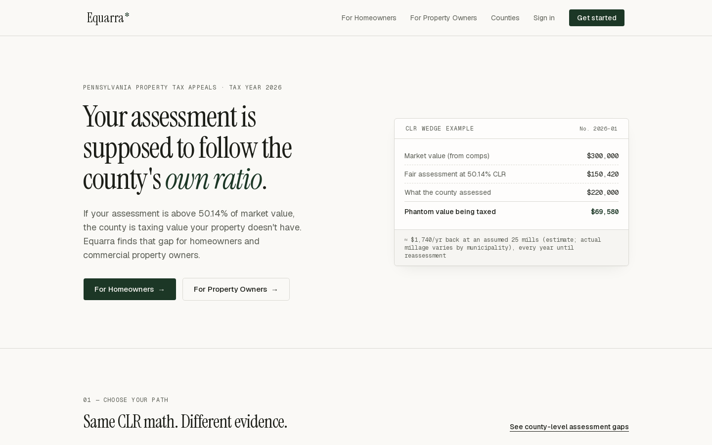
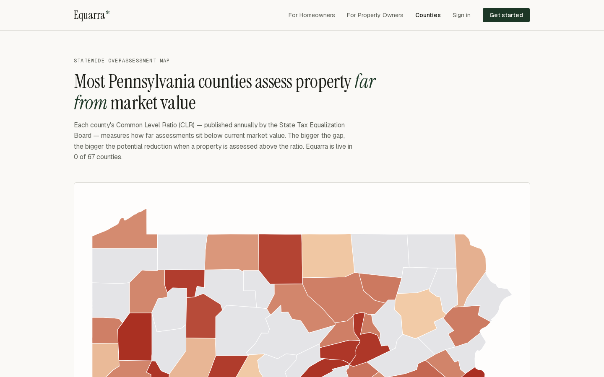

# TaxForm (Equarra): Property Tax Appeals for Allegheny County, PA

**Live demo:** https://tax-form-coral.vercel.app



## What it is

TaxForm is an AI-powered tool that helps Pennsylvania homeowners find out whether they are over-assessed and builds an evidence-backed appeal package for them. The live site runs under the working brand name Equarra.

## The problem

Allegheny County still assesses property against a **2012 base year**. Each year the state publishes a **Common Level Ratio (CLR)** that shows how far assessments have drifted from current market value. For tax year 2026 it is **50.14%**. When a home's assessed value is higher than `market value × CLR`, the owner is paying tax on value the property doesn't have. Because of how the base year and the falling ratio interact, many homeowners are over-assessed and never find out.

## How it works

1. **Look up a property** by address or parcel ID, using public county parcel and sales data (WPRDC).
2. **Comparable sales**: SQL and pgvector pull candidate comps, then Claude ranks them and applies dollar adjustments.
3. **CLR math** turns market value into a target assessment and an estimated yearly savings.
4. **Win probability**: a model trained on past appeal outcomes (BPAAR, 2015 to 2026) estimates the odds.
5. **Appeal package**: a generated letter and evidence PDF, with county-specific filing instructions and deadline reminders.



## Status

Paused. As I understood the rules, appeals like this in Pennsylvania generally need an attorney to represent the owner, and that made the full-service model hard to run here. Other states don't have that requirement, so I may come back to this for one of them.

## Stack

| Layer | Choice |
|---|---|
| Frontend | Next.js (App Router) on Vercel |
| Database | Supabase Postgres + pgvector |
| Auth | Supabase Auth (email/password + magic link, role-based) |
| File storage | Supabase Storage (`documents`, `letters` buckets) |
| AI/LLM | Anthropic Claude (comps, letters, extraction, vision) |
| Background jobs | Supabase Edge Functions + cron |
| Monitoring | Sentry |

## Features

- **Parcel + CLR ingestion** — WPRDC open data (~580k parcels, sales history,
  BPAAR appeal outcomes 2015–2026) loaded into Postgres; scheduled refresh via
  Edge Function ([supabase/functions/refresh-county-data](supabase/functions/refresh-county-data/index.ts)).
- **AI Comp Engine** — SQL + pgvector candidate retrieval, Claude ranking and
  dollar adjustments, deterministic heuristic fallback ([src/lib/comp-engine.ts](src/lib/comp-engine.ts)).
- **Free Savings Probability Score** — public, no-auth landing flow: address →
  comps → CLR math → savings + probability, cached per parcel/tax year.
- **LLM Appeal Letter Generator** — Claude letter grounded in comps, CLR math,
  and a pgvector RAG store of hearing guidance; rendered to PDF, stored in
  Supabase Storage.
- **Predictive Adjudication Model** — logistic + linear regression trained on
  ~40k historical BPAAR dispositions; coefficients stored in DB, scored in
  TypeScript at request time.
- **Commercial Document Ingestion** — rent roll / T-12 upload with Claude
  structured extraction and income-approach value indication.
- **Computer Vision module** — property photo condition analysis via Claude
  vision; findings feed comp adjustments and letter evidence.
- **Full-Service Filing Dashboard** — admin pipeline by status, filing
  deadlines, document checklists, hearing calendar (`/admin`).
- **Portfolio Analytics** — cross-property rollups with CSV export for
  commercial/multifamily clients.

## Getting started

```bash
npm install
npm run setup    # creates .env, starts DB, applies seed fixture (~440 parcels)
npm run dev
```

Open [http://localhost:3000/score?q=719+mulkerrin](http://localhost:3000/score?q=719+mulkerrin) or try the golden addresses below. Check [http://localhost:3000/api/health](http://localhost:3000/api/health) if anything looks off.

### Golden test addresses (always in the seed fixture)

| Query | Notes |
|-------|--------|
| `719 mulkerrin` | Matches the screenshot address |
| `3409 DENNY ST` | Used in production setup smoke tests |
| `429 Forbes` | Downtown commercial parcel |

Manual setup (if you prefer):

```bash
cp .env.example .env
```

### Full local stack (recommended, requires Docker)

```bash
npx supabase start        # applies migrations + seed, prints anon/service keys
# put the printed keys into .env
npm run dev
```

### Fallback without Docker

Runs Postgres 17 + pgvector via Homebrew with shimmed `auth`/`storage`
schemas. Public pages, ingestion, scoring, and letter generation work; Supabase
Auth/Storage features need the real stack.

```bash
brew install postgresql@17 pgvector
./scripts/dev/local-db.sh   # starts PG on :54322, applies migrations + seed
npm run dev
```

### Load county data

The seed fixture (~440 Allegheny parcels) is enough for search, scoring, and smoke tests. Load the full dataset when you need realistic scale:

```bash
npm run ingest:clr                        # Common Level Ratio table (also in seed)
npm run ingest:parcels -- --limit 30000   # dev subset (drop --limit for all ~580k, ~415MB CSV)
npm run ingest:appeals                    # BPAAR dispositions 2015-2026
npx tsx scripts/ingest/letter-chunks.ts   # RAG store for letter generation
npm run train:adjudication                # predictive adjudication model
```

Smoke tests: `npx tsx scripts/dev/smoke-comp.ts`, `npx tsx scripts/dev/smoke-letter.ts`.

## Environment variables

See [.env.example](.env.example). `ANTHROPIC_API_KEY` is optional in
development — every AI feature has a deterministic fallback (heuristic comps,
template letters); document extraction and photo analysis require the key.

## Deployment checklist

- [ ] Vercel project + custom domain; set all env vars from `.env.example`
- [ ] Supabase projects (staging + production), pgvector enabled (migrations handle it)
- [ ] `npx supabase db push` to apply migrations; run seed + ingestion
- [ ] Deploy Edge Function: `npx supabase functions deploy refresh-county-data`
- [ ] Schedule it (Supabase Dashboard → Integrations → Cron, e.g. hourly) to keep county data fresh
- [ ] `ANTHROPIC_API_KEY` in Vercel env vars
- [ ] Error monitoring (Sentry free tier or Vercel logs)
- [ ] Point-in-time recovery on the production Supabase project (paid tier)

## Operational notes

- Anthropic cost control: comp/valuation results are cached in
  `savings_scores` per parcel per tax year; the free score API is rate-limited.
- Appeal filing itself is manual (county portal); the dashboard tracks status,
  deadlines, and documents — there is no county e-filing API.
- The CLR is published by STEB each July — update `scripts/ingest/clr.ts` and
  re-run `npm run ingest:clr` annually.
- To promote an admin: `update clients set role = 'admin' where email = '...'`.
