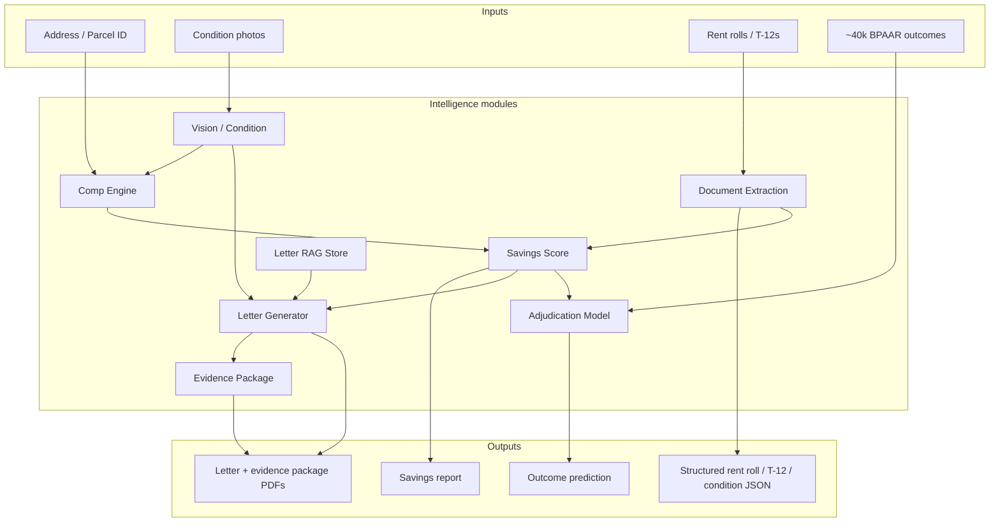

# TaxForm — Product Overview

**TaxForm** is an AI-powered property tax appeal platform for **Pennsylvania**. It helps homeowners, landlords, and commercial property owners identify over-assessment, quantify potential savings, generate evidence-backed appeal packages, and track appeals through filing and hearing.

The product is built around a structural wedge in Pennsylvania assessment law: most counties assess against a frozen **base year**, while the **Common Level Ratio (CLR)** — published annually by the State Tax Equalization Board (STEB) — measures how far current market values have drifted from that base. When a property's assessed value exceeds `fair market value × CLR`, the owner has a quantifiable case for reduction. In Allegheny County the 2026 CLR is **50.14%**; in Butler it's **6.00%**; every county's wedge is different, and TaxForm's architecture is built to exploit all of them.

**Current coverage: 11 of 67 counties live** — Allegheny, York, Cumberland, Montgomery, Butler, Indiana, Juniata, Chester, Bedford, Forest, and Franklin — with a scripted survey, ranked rollout list, and a pluggable county-adapter architecture for onboarding the rest. Philadelphia is deliberately excluded for now (recently reassessed to ~market value).

---

## Table of contents

1. [The problem we solve](#the-problem-we-solve)
2. [Statewide rollout status](#statewide-rollout-status)
3. [Who it's for](#who-its-for)
4. [Product surfaces](#product-surfaces)
5. [End-to-end user flows](#end-to-end-user-flows)
6. [County adapter architecture](#county-adapter-architecture)
7. [AI agents and intelligence modules](#ai-agents-and-intelligence-modules)
8. [Data layer](#data-layer)
9. [Notifications and background jobs](#notifications-and-background-jobs)
10. [What works today](#what-works-today)
11. [What requires setup](#what-requires-setup)
12. [Known limitations and gaps](#known-limitations-and-gaps)
13. [Architecture](#architecture)
14. [Operational playbook](#operational-playbook)
15. [Code map](#code-map)

---

## The problem we solve

Pennsylvania property owners often pay taxes on assessed values that no longer reflect market reality. Because most counties freeze assessments at a base year and the CLR only papers over the drift, many parcels are **materially over-assessed** relative to the ratio standard they are legally entitled to.

TaxForm makes that gap visible and actionable:

| Step | What the owner needs | What TaxForm does |
|------|----------------------|-------------------|
| Discovery | "Am I over-assessed?" | Free savings score from address lookup; public county map |
| Evidence | "What is my property worth?" | Comparable sales analysis with dollar adjustments; income approach for commercial |
| Legal math | "What should my assessment be?" | County-specific CLR calculation → target assessed value |
| Confidence | "Will I win?" | Probability score with a transparent confidence source (trained model vs. general estimate) |
| Filing | "What do I submit? Where?" | Full evidence-package PDF with county-specific filing instructions and mailing address |
| Tracking | "When is the deadline?" | Dashboard pipeline + automated email reminders for deadlines and hearings |

**Important:** TaxForm does **not** e-file with any county. Appeals are filed manually with each county's board (portal, mail, or hand delivery). The platform prepares evidence, generates letters and packages, tells the owner exactly where and how to file, and tracks status — the actual filing step is human-operated (DIY client or full-service team). This is a deliberate alternative to e-filing, since no PA county exposes a filing API.

---

## Statewide rollout status

### Live counties (data ingested, scoring end-to-end)

| County | Parcels | 2026 CLR | Data source | Appeal deadline |
|--------|---------|----------|-------------|-----------------|
| Allegheny | ~30k sample (full ~580k via WPRDC) | 50.14% | WPRDC (county open data) | Sep 1 (verified against BPAAR) |
| York | ~174k | 50.46% | PASDA county layer | Aug 1 |
| Cumberland | ~91k | 67.80% | PASDA PA_Parcels_2022 snapshot | Sep 1 |
| Montgomery | ~301k | 30.76% | PASDA county layer | Aug 1 |
| Butler | ~96k | 6.00% | PASDA county layer | Aug 1 |
| Indiana | ~44k | 75.32% | PASDA county layer | Aug 1 |
| Juniata | ~14k | 8.11% | PASDA county layer | Sep 1 |

Roughly **750k parcels** are loaded across the seven live counties, each with sales histories for comp retrieval. Deadlines, board names, portal URLs, and mailing addresses live in the `appeal_windows` table (seeded for 2026 and 2027).

### The other 60 counties

A scripted survey (`scripts/survey/county-data.ts`) probed PASDA and known county portals for every county, checking whether free parcel layers carry assessed values and sale fields (not just boundary geometry). Results populate `county_data_status` for all 67 counties:

- **Tier A** — usable free data in PASDA (the batch-onboarding path)
- **Tier B** — county runs its own open-data portal with usable fields (custom importer each)
- **Tier C** — no free parcel-level data; deferred until revenue justifies paid data

Crossed with **wedge strength** (STEB CLR vs. predetermined-ratio flags), this produces a ranked rollout list committed at `docs/county-rollout.md` (rerunning the survey also emits raw probe output to `data/county-survey.json`). Counties whose STEB predetermined ratio is below 100% (raw CLR overstates the wedge) or that recently reassessed to market are marked accordingly and shown honestly on the public map.

---

## Who it's for

Three client tiers are modeled in the database (`client_tier` enum):

| Tier | Intended use |
|------|--------------|
| `residential_diy` | Homeowners who check their score for free and self-file with generated letters |
| `commercial_contingency` | Multifamily / commercial owners who upload rent rolls and T-12s for income-approach evidence |
| `full_service` | Clients whose appeals are managed end-to-end by TaxForm staff (admin dashboard) |

Roles: `client` (default) and `admin` (access to `/admin` filing dashboard, assignable to appeals via `appeals.assigned_admin_id`). Admins are promoted manually in the database.

Every client also gets a **referral code** (`clients.referral_code`); signups via `/signup?ref=CODE` record attribution in `clients.referred_by`. The dashboard surfaces a shareable link ("overassessment runs street by street").

---

## Product surfaces

### Public (no auth)

| Route | Purpose |
|-------|---------|
| `/` | Landing page with address search, CLR explanation, worked example |
| `/counties` | **Statewide overassessment map**: all 67 counties shaded by assessment gap, live counties highlighted, ranked table (SEO/PR asset + rollout dashboard) |
| `/counties/[county]` | Per-county landing page: CLR, deadline, board, worked math, aggregate overassessment stats for live counties, search CTA |
| `/score?q=…` | Parcel search by address or parcel ID (formats vary by county) |
| `/score/[parid]` | Full savings report: FMV, CLR math, comps, probability, CTA to sign up |
| `/api/score/[parid]` | JSON API for savings score (distributed rate limit, cached) |

### Authenticated client dashboard

| Route | Purpose |
|-------|---------|
| `/dashboard` | Overview: property count, active appeals, recent activity, referral link |
| `/dashboard/properties` | Add/remove tracked parcels via county search |
| `/dashboard/appeals` | Start appeals for the current tax year, list all appeals |
| `/dashboard/appeals/[id]` | Appeal detail: case value, outcome prediction with confidence source, letter + evidence package generation, status updates, documents |
| `/dashboard/documents` | Upload rent rolls, T-12s, condition photos; trigger AI processing |
| `/dashboard/portfolio` | Cross-property rollups with CSV export |

### Admin

| Route | Purpose |
|-------|---------|
| `/admin` | Filing pipeline: status counts, filing deadlines, hearing calendar, evidence checklists, and per-appeal **admin assignment** dropdown |

### Background job endpoints (cron, `CRON_SECRET`-protected)

| Route | Schedule (vercel.json) | Purpose |
|-------|------------------------|---------|
| `/api/jobs/reminders` | Daily 12:00 UTC | Filing-deadline (14d/3d) and hearing (7d) reminder emails |
| `/api/jobs/assessment-watch` | Weekly Mon 13:00 UTC | Detect assessed-value changes on tracked parcels, alert owners |

### Auth

| Route | Purpose |
|-------|---------|
| `/login`, `/signup` | Supabase Auth (email/password); `/signup?ref=CODE` for referrals |
| `/auth/callback` | OAuth/session callback |

---

## End-to-end user flows

### Flow 1 — Free savings score (acquisition funnel)

```
County map or landing page → address search → parcel picker → savings report
```

1. User arrives via `/`, `/counties`, or a county landing page.
2. `searchParcels()` queries Postgres with trigram similarity on `full_address` (exact match for 13–16 digit parcel IDs across county formats).
3. User selects a parcel → `/score/[parid]`.
4. `computeSavingsScore()` runs the full pipeline (see [Savings Score orchestrator](#2-savings-score-orchestrator)) using the parcel's county adapter for CLR, millage, and comp-window rules.
5. Results are displayed and cached in `savings_scores` per parcel per tax year, with explicit "estimate" labeling wherever millage is defaulted.
6. CTA prompts signup to start a formal appeal.

No account required. This is the top-of-funnel product; county landing pages are the SEO entry points.

### Flow 2 — DIY residential appeal

```
Sign up → add property → start appeal → upload photos (optional) → generate letter/package → file manually → update status
```

1. User creates account; Supabase trigger mirrors them into `clients` (with referral code and attribution).
2. User adds parcel(s) on `/dashboard/properties`.
3. User starts an appeal on `/dashboard/appeals` — tax year and filing deadline come from the parcel's county adapter (`appeal_windows` row or rule-based fallback).
4. Optional: upload condition photos on `/dashboard/documents` and run processing.
5. On the appeal detail page, generate the **appeal letter** (PDF) or the **full evidence package** (PDF with cover page, county filing instructions incl. mailing address, letter, CLR math table, per-comp adjustment detail, condition report, exhibits checklist).
6. User files with the county board, then updates appeal status (filed → hearing scheduled → decided).
7. Automated emails remind the user at 14 and 3 days before an unfiled deadline and 7 days before a hearing.

### Flow 3 — Commercial / multifamily appeal

Same as Flow 2, plus:

1. Upload **rent roll** and/or **T-12** operating statement.
2. Click **Process** → Commercial Document Ingestion Engine extracts structured data.
3. T-12 processing attaches an **income-approach value indication** (NOI ÷ cap rate) and refreshes the savings score.
4. The savings score computes **both** valuation approaches — comp-based and income-based — and adopts the **lower** (most favorable for appeal). Both are stored in `savings_scores.inputs` and shown side-by-side in the UI and the evidence package.
5. Commercial comps use commercial-specific adjustment logic (price-per-sqft area scaling instead of residential bed/bath heuristics).
6. Admin checklist on `/admin` tracks rent roll + T-12 + photos + letter completion.

### Flow 4 — Full-service (admin-operated)

1. Admin views `/admin` pipeline across all clients.
2. Assigns each appeal to a specific admin (`assigned_admin_id`).
3. Monitors filing deadlines and upcoming hearings.
4. Reviews evidence checklists (letter, photos, rent roll, T-12).
5. Operates appeals on behalf of `full_service` tier clients.

---

## County adapter architecture

Everything county-specific sits behind a `CountyAdapter` interface (`src/lib/counties/types.ts`), registered in `src/lib/counties/registry.ts`:

```ts
interface CountyAdapter {
  county: string;
  dataTier: "A" | "B" | "C";
  wedgeStrength: "strong" | "moderate" | "weak";
  parcelSource: ParcelIngestAdapter;      // pasda | county-portal | manual
  clr: () => Promise<ClrRow>;             // from common_level_ratio (county, tax_year)
  appealWindow: (today?: Date) => Promise<AppealWindow>;  // DB row → rule fallback
  millageTable: MillageLookup;            // muni+school → combined mills, or null
  hasHistoricalOutcomes: boolean;         // drives trained-model vs pooled heuristic
  compSaleYears?: number;                 // widened for stale data snapshots (default 3)
}
```

- **`allegheny.ts`** — WPRDC-backed, verified Sep 1 deadline, ~40k BPAAR outcomes (`hasHistoricalOutcomes: true`).
- **`york.ts`** — PASDA-backed with a dedicated importer (`scripts/ingest/york.ts`), real 2025 millage table (74 rows ingested from the county PDF), Aug 1 deadline rule, `compSaleYears: 6` (2022 data snapshot).
- **`batch.ts`** — a `makePasdaAdapter()` factory generating adapters for Cumberland, Montgomery, Butler, Indiana, Juniata, Chester, Bedford, Forest, and Franklin. Ingested by the config-driven `scripts/ingest/pasda.ts` (`npm run ingest:pasda -- --county <name>`).

`comp_candidates()` (SQL RPC) is strictly **county-scoped** — comps never cross county lines — and accepts a per-county `max_sale_age_years` so counties with older free-data snapshots still find comps (with market-time adjustments doing the work).

An unknown county throws at the registry: by construction, any parcel in the database belongs to an onboarded county.

---

## AI agents and intelligence modules

TaxForm uses several specialized "agents" — modules that perform a distinct intelligence task. Some use Claude (Anthropic); others use deterministic algorithms or classical ML. Every Claude-powered agent has a **fallback** so the product works without an API key in development.



---

### 1. Comp Engine

**File:** `src/lib/comp-engine.ts`
**Model:** Claude Sonnet 4.5 (tool-use) + deterministic heuristic fallback
**Trigger:** Every savings score computation, letter generation (via score refresh)

**What it does:**

1. **Retrieval** — Calls Postgres function `comp_candidates(parid, limit, max_sale_age_years)` which:
   - Finds parcels **in the same county** and same municipality or school district with the same property class
   - Filters to similar living area (±40%)
   - Requires a valid arm's-length sale within the county's comp window (default 3 years; widened per adapter for stale snapshots)
   - Ranks by L2 distance on a 16-dimensional characteristic vector (pgvector)

2. **Valuation** — With `ANTHROPIC_API_KEY`:
   - Sends subject parcel + up to 12 comps to Claude (prompt is county-aware)
   - Claude selects strongest comps, applies dollar adjustments (time, living area, baths, condition, grade, lot)
   - Returns concluded FMV, weighted comps, and a narrative suitable for an appeal letter

3. **Fallback** — Without API key or on Claude failure, a deterministic heuristic:
   - **Residential:** time adjustment (3%/yr), living area (50% of $/sqft delta), bathroom count ($5k/bath)
   - **Commercial:** time adjustment + full price-per-sqft building-area scaling (capped at the retrieval band); bed/bath logic skipped
   - **Condition severity adjustment** from photo findings applies in the heuristic path too (not just Claude)
   - Weighted by inverse distance from characteristic vector
   - If no comps exist, falls back to the county-published fair market value only; if that's also absent (base-year counties), the score honestly returns *no estimate* rather than fabricating one from the assessed value

**Condition integration:** If condition photo findings exist (`getConditionContext()`), they influence both the Claude and heuristic paths. Cached scores are bypassed when condition evidence is present.

**Output:** `CompResult` — `{ estimated_fmv, comps[], narrative, method: "claude" | "heuristic" }`

---

### 2. Savings Score orchestrator

**File:** `src/lib/savings.ts`
**Model:** Orchestration layer (not an LLM)
**Trigger:** `/score/[parid]`, `/api/score/[parid]`, appeal detail pages, letter generation

**What it does:**

1. Resolves the parcel's **county adapter**; loads that county's current CLR from `common_level_ratio (county, tax_year)`
2. Checks `savings_scores` cache (skipped on refresh or when condition context changes)
3. Calls Comp Engine for the comp-based FMV
4. For **commercial** parcels, also looks up the latest processed T-12 income-approach indication and adopts the **lower** of the two FMVs; both approaches (with cap rate and NOI) are stored in `inputs` JSONB and rendered in the UI
5. Applies CLR math (`src/lib/clr.ts`):
   - `implied_assessed = estimated_fmv × CLR`
   - `assessment_reduction = max(0, current_assessed − implied_assessed)`
   - `estimated_annual_savings = assessment_reduction × millage / 1000`
6. **Millage** comes from the adapter's `millage_rates` lookup (muni + school district). When no row exists, a 25-mill default is used and the result is explicitly labeled `default_estimate` — every surface that renders savings adapts its copy ("actual millage" vs. "estimate, assumes ~25 mills")
7. Computes **success probability** as a blend of gap probability (logistic curve on over-assessment ratio) and the county's owner-filed historical win rate, with a `probability_basis` of `county_history` or `general_estimate` shown in the UI
8. Persists to `savings_scores` with full comp snapshot, valuation approaches, millage source, and probability basis in `inputs` JSONB

**Output:** `SavingsScore` — the primary product artifact for the free tier

---

### 3. Predictive Adjudication Model

**File:** `src/lib/adjudication.ts` + `src/lib/adjudication-features.ts`
**Training:** `scripts/train/adjudication.ts` (`--county <name>`)
**Model:** Logistic regression + linear regression (classical ML, not LLM), per county
**Trigger:** Appeal detail page (`getOrCreatePrediction()`)

**What it does:**

Models are trained **per county** (`adjudication:<county>` in `model_versions`). Allegheny has ~40,000 historical BPAAR dispositions in `appeal_outcomes`; other counties start without local outcome data.

| Component | Predicts |
|-----------|----------|
| Logistic regression | P(assessment reduced) for owner-filed appeals |
| Linear regression | Expected reduction % given a reduction occurs |

**Features:** assessment gap ratio, residential/commercial flags, CLR, owner-filed flag, log(pre-appeal total)

**Routing at request time:**

- County has a trained model → score with it; UI labels the prediction **"based on N historical decisions"** (`confidence_source: "trained"`)
- No trained model → a **pooled feature-based heuristic** (same feature vector, hand-set coefficients); UI labels it **"general estimate; local decision data not yet available"** (`confidence_source: "heuristic"`)
- A county is promoted to its own trained model once it accumulates **300+** outcomes (`LOCAL_MODEL_PROMOTION_THRESHOLD`); the training script enforces this

**Output:** `{ probability_reduction, expected_reduction_pct, confidence_source, training_note }` stored in `predictions`

---

### 4. Appeal Letter Generator

**File:** `src/lib/letters.ts`
**Model:** Claude Sonnet 4.5 + RAG + template fallback
**Trigger:** `POST /api/appeals/[id]/letter`

**What it does:**

1. Refreshes savings score with any condition photo context
2. **RAG retrieval** — embeds a query string (Voyage AI if configured, hashing fallback), calls `match_letter_chunks()` for top-5 similar chunks from `letter_chunks` (board guidance, letter patterns)
3. **Generation** — Claude drafts a written submission addressed to the **parcel county's board** using owner name, parcel details, comp table, county CLR math, both valuation approaches (commercial), and condition findings
4. **Fallback** — Deterministic template letter with the same data fields, county-aware
5. **PDF rendering** — `pdf-lib` renders Times Roman letter-format PDF
6. **Persistence** — Uploads to `letters` Storage bucket, creates `documents` row, links to appeal, sets status to `ready_to_file`

**RAG store seeded by:** `npx tsx scripts/ingest/letter-chunks.ts` — chunks upsert by title, so switching embedding models (hashing → Voyage) re-embeds in place.

**Output:** PDF download + stored document record

---

### 5. Evidence Package Generator

**File:** `src/lib/evidence-package.ts`
**Model:** None (composes Letter Generator output; pure `pdf-lib`)
**Trigger:** `POST /api/appeals/[id]/package`

**What it does:** renders the complete filing-ready PDF:

1. **Cover page** — property, parcel, county, owner, tax year, board, deadline, and the headline numbers (current assessed, concluded FMV, CLR, requested assessed value and reduction)
2. **County filing instructions** — board name, open/close dates, portal URL, and **mailing address** (from `appeal_windows.mailing_address`), with step-by-step filing directions
3. **Appeal letter** — full text from the Letter Generator
4. **CLR calculation table** — including both valuation approaches for commercial parcels
5. **Comparable sales** — one section per comp with sale details, itemized dollar adjustments, adjusted value, and weight
6. **Property condition report** — when photo findings exist
7. **Exhibits checklist** — tailored to what the client has uploaded

Stored as a `documents` row (`type: evidence_package`) in the `letters` bucket. Smoke test: `npx tsx scripts/dev/smoke-package.ts [parid]`.

---

### 6. Commercial Document Ingestion Engine

**File:** `src/lib/extraction.ts`
**Model:** Claude Sonnet 4.5 (tool-use with structured schemas)
**Trigger:** `POST /api/documents/[id]/process` for `rent_roll` or `t12` types

**What it does:**

Accepts PDF, CSV/text, or image scans and extracts:

| Document | Structured output |
|----------|-------------------|
| Rent roll | Unit rows (sqft, tenant, rent, occupancy), totals, occupancy rate |
| T-12 | Income lines, expense lines, NOI; plus income-approach value (NOI ÷ cap rate by property type) |

**Cap rates (defaults):** apartments 7%, office 9%, retail/commercial 8%, warehouse/industrial 7.5%, other 8.5%

Processing a T-12 **refreshes the parcel's savings score** so the income approach immediately feeds the valuation.

**Requires:** `ANTHROPIC_API_KEY` — no fallback. Returns 503 if unconfigured.

**Output:** JSON stored in `documents.extracted_json`

---

### 7. Computer Vision / Condition Analysis

**File:** `src/lib/vision.ts`
**Model:** Claude Sonnet 4.5 (vision + tool-use)
**Trigger:** `POST /api/documents/[id]/process` for `photo` type

**What it does:**

1. Analyzes property photos for observable condition issues
2. Returns structured findings: overall condition, severity per issue, estimated cost-to-cure, summary text
3. Aggregates all processed photos for a parcel via `getConditionContext()` into a text block

**Downstream consumers:**

- **Comp Engine** — condition context adjusts both the Claude and heuristic paths
- **Letter Generator / Evidence Package** — condition section in the letter and a dedicated condition-report page in the package
- **Savings Score** — bypasses cache when condition evidence exists (re-runs valuation)

**Requires:** `ANTHROPIC_API_KEY` — no fallback.

---

### 8. Embeddings

**File:** `src/lib/embeddings.ts`

Two distinct embedding systems:

| Store | Dimensions | Method |
|-------|-----------|--------|
| `parcels.embedding` (comp similarity) | 16 | Deterministic feature vector from parcel characteristics — intentionally not an LLM |
| `letter_chunks.embedding` (letter RAG) | 384 | **Voyage AI** (512-dim request, truncated + renormalized to 384) when `VOYAGE_API_KEY` is set; FNV-1a feature hashing fallback otherwise |

`embedTexts()` is the single entry point that routes to Voyage or hashing. Re-run `letter-chunks.ts` after switching methods so the store and queries agree.

---

### 9. County Data Refresh (background, non-AI)

**File:** `supabase/functions/refresh-county-data/index.ts`
**Model:** None — scheduled Edge Function
**Trigger:** Supabase cron (intended hourly)

**What it does:**

1. Resumes Allegheny parcel ingestion from the WPRDC datastore API cursor in `ingest_state`
2. Upserts ~30k parcels per run (6 pages × 5k records)
3. Refreshes tail of BPAAR appeal outcomes dataset

Initial bulk loads are done via the ingest scripts; this function keeps Allegheny fresh afterward. PASDA counties are refreshed by re-running their ingest scripts when PASDA publishes new snapshots.

---

### 10. Letter Verification Agent

**File:** `src/lib/letter-verifier.ts`
**Model:** Deterministic-first (dollar/address/CLR diff) + optional Claude narrative pass (`verifyLetterNarrative`)
**Trigger:** Automatically after `generateLetterText` in `POST /api/appeals/[id]/letter` and `/package`

**What it does:**

1. Parses every `$` amount and CLR-scale `%` from the drafted letter text
2. Diff against the `SavingsScore` snapshot (assessment figures, comp prices/adjustments, addresses)
3. On mismatch: sets `documents.needs_review = true` and **does not** advance appeal status to `ready_to_file`
4. Surfaces a warning banner on the appeal detail page

**Smoke test:** `npm run smoke:letter-verify`

---

### 11. Document Reconciliation Agent

**File:** `src/lib/reconciliation.ts`
**Model:** None — arithmetic on extracted JSON
**Trigger:** `POST /api/documents/[id]/process` after rent-roll/T-12 extraction

**What it does:**

- Rent roll: unit rent sum vs. stated total (2% tolerance), unit/occupied counts
- T-12: income − expenses vs. stated NOI, component sums, truncation heuristics
- On failure: `documents.needs_review = true` (processing continues; income approach still attaches)

**Smoke test:** `npm run smoke:reconcile`

---

### 12. County Expansion Agent

**File:** `scripts/agents/county-onboarder.ts`
**Model:** None for probing; drafts code blocks for human review
**Trigger:** Manual — `npm run agent:onboard -- --county <name>` or `--batch N`

**What it does:** Re-probes PASDA layers, drafts `CountyConfig` + `makePasdaAdapter()` blocks, CLR entry, and `appeal_windows` SQL template. Output: `docs/county-rollout/<county>.md`. Never auto-publishes filing-critical data.

---

### 13. Appeal Window Verification Agent

**File:** `scripts/agents/verify-appeal-windows.ts`
**Model:** Claude-assisted diff (optional)
**Trigger:** Manual each spring — `npm run agent:windows`

**What it does:** Fetches each live county's portal page (or `--paste` fallback), diffs against stored `appeal_windows` rows. Output: `docs/appeal-window-review-<year>.md`. Never auto-applies changes.

---

### 14. Millage Ingestion Agent

**File:** `scripts/agents/ingest-millage.ts`
**Model:** Claude PDF extraction
**Trigger:** Manual per county — `npm run agent:millage -- --county <name> --source <pdf-or-url>`

**What it does:** Extracts muni/school/county mills from a county publication, validates names against `parcels`, emits draft SQL to `data/millage-drafts/`. Human reviews before applying migration.

---

### 15. Commercial Prospecting Agent (GTM)

**File:** `scripts/agents/commercial-prospects.ts`
**Model:** Optional Claude for `--draft-emails`
**Trigger:** Manual — `npm run agent:prospects`

**What it does:** Ranks commercial parcels by CLR-implied assessment gap per live county; enriches top prospects with owner/mailing from county ArcGIS layers. Output: `data/prospects/<county>-prospects.csv`.

---

### Agent dependency matrix

| Agent | Requires Anthropic key | Has fallback | Requires county data | Requires Supabase Storage |
|-------|------------------------|--------------|----------------------|---------------------------|
| Comp Engine | Optional | Yes (heuristic) | Yes (parcels + sales) | No |
| Savings Score | Optional (via Comp Engine) | Yes | Yes | No |
| Adjudication Model | No | Yes (pooled heuristic) | Trained model optional per county | No |
| Letter Generator | Optional | Yes (template) | Yes | Yes (for persistence) |
| Evidence Package | No (uses letter output) | N/A | Yes | Yes (for persistence) |
| Document Extraction | **Required** | No | No | Yes |
| Condition Vision | **Required** | No | No | Yes |
| Letter RAG embeddings | No (Voyage optional) | Yes (hashing) | No | No |
| County Refresh | No | N/A | WPRDC API | No |
| Letter Verification | Optional (narrative only) | Yes (deterministic) | Yes (score snapshot) | No |
| Document Reconciliation | No | N/A | No | No |
| County Expansion Agent | No | N/A | Survey data | No |
| Appeal Window Verification | Optional | Yes (fetch/paste) | appeal_windows rows | No |
| Millage Ingestion | **Required** | No | Parcels (name validation) | No |
| Commercial Prospecting | Optional (emails) | Yes (CSV only) | Yes (parcels + sales) | No |

---

## Data layer

### County reference data (public read via RLS)

| Table | Source | Records | Purpose |
|-------|--------|---------|---------|
| `parcels` | WPRDC (Allegheny) + PASDA (10 counties) | ~750k+ across 11 counties | Assessment records, building characteristics, `county` column, 16-dim embedding |
| `sales` | Same datasets (sale fields) | Hundreds of thousands | Comp candidate sales history |
| `common_level_ratio` | STEB, keyed by `(county, tax_year)` | Per county per year | CLR wedge math |
| `appeal_outcomes` | WPRDC BPAAR dispositions 2015–2026 (`county` column) | ~40k+ (Allegheny) | Adjudication training, historical win rates |
| `appeal_windows` | County board pages (manually verified) | Per county per tax year | Board name, open/close dates, portal URL, **mailing address** |
| `millage_rates` | County millage publications (manual entry) | York: 74 rows (2025) | Actual muni+school+county mills for savings math |
| `county_data_status` | Survey script | All 67 counties | Data tier, wedge strength, data flags, `onboarded_at`, notes |
| `letter_chunks` | Curated board guidance (unique by title) | ~10 chunks | Letter RAG store |
| `savings_scores` | Computed at runtime | Per parcel per tax year | Cached valuation results (approaches, millage source, probability basis in `inputs`) |
| `rate_limits` | Runtime | Rolling | Postgres fallback counter for distributed rate limiting |

### Client data (RLS-protected)

| Table | Purpose |
|-------|---------|
| `clients` | User profile, tier, role, `referral_code`, `referred_by` (mirrored from `auth.users`) |
| `client_properties` | Parcels a client tracks + `last_known_assessed` / `assessed_changed_at` (watcher state) |
| `appeals` | Appeal records with status pipeline + `assigned_admin_id` |
| `documents` | Uploaded files + extraction results (`document_type` incl. `appeal_letter`, `evidence_package`); `needs_review` flag for verification/reconciliation failures |
| `predictions` | Adjudication outputs per appeal (with confidence source) |
| `model_versions` | Trained model coefficients, named `adjudication:<county>` |
| `notifications` | Email audit + dedupe log (owner-readable; failed sends retry on next cron) |
| `invoices` | Stripe billing audit (`diy_flat`, `contingency`, `retainer`) |

### Storage buckets

| Bucket | Contents |
|--------|----------|
| `documents` | Rent rolls, T-12s, photos |
| `letters` | Generated appeal letter and evidence package PDFs |

### Key Postgres functions

| Function | Purpose |
|----------|---------|
| `comp_candidates(parid, limit, max_sale_age_years)` | County-scoped pgvector + SQL comp retrieval |
| `match_letter_chunks(embedding, count)` | Cosine similarity RAG search |
| `handle_new_user()` | Auth trigger: mirrors signups into `clients`, generates referral code, resolves referral attribution |
| `is_admin()` | Security-definer RLS helper |

### Static reference modules

| File | Purpose |
|------|---------|
| `src/lib/steb.ts` | STEB 2026 CLRs + PDR/reassessment flags for all 67 counties; county slugs; wedge math (shared by the survey script, map, and landing pages) |
| `src/lib/pa-counties-geo.json` | Pre-projected SVG path per county for the `/counties` map (generated by `scripts/dev/build-county-geometry.ts`) |

---

## Notifications and background jobs

**File:** `src/lib/notifications.ts` — Resend-backed email with a Postgres dedupe/audit table.

| Job | Route + cron | What it sends |
|-----|--------------|---------------|
| Reminders | `/api/jobs/reminders`, daily | Deadline reminders at 14 and 3 days out for unfiled appeals (draft / ready-to-file); hearing reminders 7 days out |
| Assessment watch | `/api/jobs/assessment-watch`, weekly | First run silently baselines `last_known_assessed` on tracked parcels; later runs email owners when the county's assessed total changes (reassessment, appeal decision, interim revision) |

Mechanics:

- One `notifications` row per `(kind, entity, occasion)` via a unique `dedupe_key`; a send failure (e.g. Resend not yet configured) leaves `sent_at` null and **retries on the next run** instead of being consumed
- Routes require `Authorization: Bearer $CRON_SECRET`; schedules live in `vercel.json`
- Requires `RESEND_API_KEY` (+ optional `EMAIL_FROM`); without it, jobs run and log but deliver nothing

**Rate limiting** (`src/lib/rate-limit.ts`): the public score API uses **Upstash Redis** when `UPSTASH_REDIS_REST_URL`/`TOKEN` are configured, falling back to an atomic Postgres counter (`rate_limits`) — correct across serverless instances either way.

---

## What works today

These features are implemented and functional when the stack is properly configured:

### Core product

- [x] Public landing page with CLR-aware messaging and address search
- [x] **Statewide overassessment map** (`/counties`) with all 67 counties, wedge shading, live-county highlighting
- [x] **Per-county landing pages** for all 67 counties (CLR, deadline, board, worked math, live-county stats + search)
- [x] Parcel search across county ID formats (trigram address match + exact parcel ID)
- [x] Free savings score page with comps table, county CLR math, both valuation approaches (commercial), probability meter with confidence source
- [x] Savings score JSON API with distributed rate limiting (Upstash/Postgres) and DB caching
- [x] User signup/login via Supabase Auth; referral codes and attribution
- [x] Property tracking (add/remove parcels)
- [x] Appeal creation with county-correct tax year and filing deadline
- [x] Appeal status pipeline (draft → ready to file → filed → hearing → decided)
- [x] Appeal letter generation (Claude or template) → PDF download
- [x] **Full evidence package PDF** (cover, filing instructions with mailing address, letter, CLR table, comp pages, condition report, exhibits checklist)
- [x] Document upload and AI processing (rent roll, T-12, photos)
- [x] Portfolio analytics with CSV export
- [x] Admin filing dashboard with deadlines, hearings, checklists, and **admin assignment**
- [x] **Email reminders** (deadlines, hearings) and **assessment-change watcher** via cron routes

### Intelligence

- [x] Comp Engine with county-scoped pgvector retrieval + Claude ranking + heuristic fallback
- [x] Commercial-specific comp adjustments (price-per-sqft scaling)
- [x] Condition-severity adjustments in **both** Claude and heuristic paths
- [x] County CLR math with actual millage when available, labeled estimates otherwise
- [x] Income-approach FMV integrated into savings (lower-of for commercial)
- [x] Per-county adjudication models + pooled heuristic with transparent confidence labeling and a 300-outcome promotion threshold
- [x] Letter RAG with Voyage AI embeddings (hashing fallback)
- [x] Commercial document structured extraction
- [x] Photo condition analysis feeding comps, letters, and packages

### Data & ops

- [x] Full Postgres schema with RLS; multi-county keys throughout
- [x] Scripted 67-county data survey → `county_data_status` + committed ranked rollout list
- [x] Ingestion scripts: CLR (multi-county), Allegheny parcels/appeals, York importer, generic PASDA importer, letter chunks
- [x] ~750k parcels + sales live across 11 counties
- [x] Smoke tests: comp engine, letter, evidence package
- [x] Local dev with Supabase Docker or Homebrew Postgres fallback
- [x] Edge Function for incremental Allegheny refresh; vercel.json crons for jobs

---

## What requires setup

### Minimum (public score works)

```bash
npm install
npm run setup    # .env + DB + seed fixture — search works immediately
npm run dev
```

Optional full Allegheny dataset:

```bash
npm run ingest:parcels -- --limit 30000   # or drop --limit for ~580k
```

### Full intelligence stack

```bash
npm run ingest:clr                          # all live counties' CLRs
npm run ingest:parcels                      # Allegheny (drop --limit for ~580k)
npm run ingest:appeals                      # BPAAR outcomes
npm run ingest:york                         # York parcels + sales (PASDA)
npm run ingest:pasda -- --county Cumberland # repeat for Montgomery, Butler, Indiana, Juniata
npx tsx scripts/ingest/letter-chunks.ts     # letter RAG (re-run if switching to Voyage)
npm run train:adjudication                  # Allegheny model (--county <name> once ≥300 outcomes)
```

### Environment variables

| Variable | Required for |
|----------|--------------|
| `DATABASE_URL` | Everything (use the Supabase **session pooler** URL on IPv4-only networks). Health: `GET /api/health` |
| `NEXT_PUBLIC_SUPABASE_URL` / anon key | Auth, client dashboard |
| `SUPABASE_SERVICE_ROLE_KEY` | Storage uploads, document persistence |
| `ANTHROPIC_API_KEY` | Claude comps/letters, extraction, vision |
| `VOYAGE_API_KEY` | Real letter-RAG embeddings (optional; hashing fallback) |
| `UPSTASH_REDIS_REST_URL` / `UPSTASH_REDIS_REST_TOKEN` | Redis rate limiting (optional; Postgres fallback) |
| `RESEND_API_KEY`, `EMAIL_FROM` | Reminder / watcher emails |
| `CRON_SECRET` | Authorizes `/api/jobs/*` routes |
| `NEXT_PUBLIC_SITE_URL` | Links in emails and referral URLs |

### Production deployment

- [ ] Vercel project with env vars above (crons in `vercel.json` activate automatically)
- [ ] Supabase production with pgvector; `npx supabase db push` + seed + full ingestion
- [ ] Deploy and cron-schedule `refresh-county-data` Edge Function (Allegheny freshness)
- [x] Letter verification agent (deterministic-first; blocks `ready_to_file` on mismatch)
- [x] Document reconciliation agent (rent roll / T-12 sanity checks)
- [x] County expansion, appeal-window, millage, and commercial-prospecting agent scripts
- [x] Stripe billing (DIY checkout + admin contingency invoicing) — requires env keys
- [x] Sentry instrumentation (enabled when `NEXT_PUBLIC_SENTRY_DSN` is set)
- [ ] Point-in-time recovery on prod Supabase (dashboard step — see `docs/production-ops.md`)
- [ ] Point-in-time recovery on production Supabase

### Promote an admin

```sql
update clients set role = 'admin' where email = 'you@example.com';
```

---

## Known limitations and gaps

### Product / business

| Limitation | Detail |
|------------|--------|
| No e-filing | No PA county exposes a filing API; filing is manual (the evidence package includes exact instructions per county) |
| 11 of 67 counties | Tier B counties each need a custom importer; Tier C counties have no free data (deferred) |
| Millage is approximate outside York | Only York has a real millage table so far; other counties use the labeled 25-mill default until their tables are entered (millage agent drafts SQL for review) |
| Client tiers | DIY tier gated by Stripe checkout when configured; commercial contingency invoiced from admin |
| Payments | Stripe checkout (DIY) + admin contingency invoicing; webhook at `/api/webhooks/stripe` |

### Technical

| Limitation | Detail |
|------------|--------|
| PASDA data vintage varies | Some county snapshots are 2021–2023; comp windows are widened per adapter (e.g. York 6 years) and time-adjusted, but concluded values inherit snapshot staleness |
| Non-Allegheny outcome data | No county besides Allegheny has appeal outcomes yet, so their predictions use the pooled heuristic (transparently labeled) until 300+ local outcomes accumulate |
| Sparse building characteristics in some counties | Butler's PASDA layer lacks living area / beds / baths; comps there lean on assessed-value similarity and location |
| Auth/Storage need real Supabase | Homebrew Postgres fallback skips Auth and Storage features |
| Landing pages render on demand | Prerendering all 67 county pages exhausts the Supabase session pooler; pages use daily ISR instead |
| County page aggregate stats are heuristics | "% of recently sold parcels above the CLR standard" uses a 3-year window relative to each county's snapshot |

### Not yet built

- Automated appeal filing (deliberately out of scope)
- Billing / Stripe integration
- Remaining 60 counties (ranked list committed; Tier B importers and Tier C data acquisition pending)
- Magic-link-only auth UI (schema supports it; UI is email/password)
- Referral rewards mechanics (attribution only)

---

## Architecture

### Stack

| Layer | Technology |
|-------|------------|
| Frontend | Next.js 16 (App Router), React 19, Tailwind 4, shadcn/ui |
| Hosting | Vercel (intended), with `vercel.json` crons |
| Database | Supabase Postgres 17 + pgvector + pg_trgm |
| Auth | Supabase Auth |
| Storage | Supabase Storage |
| AI | Anthropic Claude Sonnet 4.5; Voyage AI embeddings (optional) |
| Email | Resend (REST API, no SDK) |
| Rate limiting | Upstash Redis → Postgres fallback |
| Background jobs | Vercel crons (`/api/jobs/*`) + Supabase Edge Function |
| Direct DB access | `pg` pool for reference-data queries and ingestion (RLS enforced for client data via Supabase clients) |

### Request path (savings score)

```
Browser → Next.js SSR (/score/[parid])
       → computeSavingsScore()
       → getCountyAdapter(parcel.county)
       → [cache hit?] → savings_scores table
       → [cache miss] → estimateFmv()
                        → comp_candidates() SQL (county-scoped)
                        → Claude or heuristic (res/comm branches)
                        → [commercial] lower of comp vs income approach
       → clrMath() with adapter CLR + millage lookup
       → ownerSuccessRate() SQL (county-scoped, with basis label)
       → persist + render
```

### Security model

- **Public read** on reference tables (parcels, sales, CLR, appeal windows, millage, county status, outcomes, savings scores)
- **RLS** on all client-owned rows (`client_id = auth.uid()`); notifications owner-readable
- **Admin bypass** via `is_admin()` security definer function; admin assignment writes go through RLS
- **Service role** used server-side for Storage uploads and document processing
- **Cron routes** authenticated by `CRON_SECRET` bearer token
- API routes validate auth via Supabase session; document/letter/package routes confirm ownership via RLS-scoped reads

---

## Operational playbook

### Annual CLR update (every July)

1. STEB publishes new ratios for all 67 counties
2. Update `scripts/ingest/clr.ts` (live counties) and `src/lib/steb.ts` (statewide map/landing data) with the new year
3. Run `npm run ingest:clr`
4. Cached `savings_scores` for prior tax years remain valid; new-year scores compute on next request

### Annual appeal-window update

1. Verify each live county's open/close dates and board details on the county board's page
2. Insert next-year rows into `appeal_windows` (including `mailing_address`); adapters fall back to rule-based dates if a row is missing

### Onboarding a new county (Tier A playbook)

1. Check `docs/county-rollout.md` for the next ranked county
2. Add a config block to `scripts/ingest/pasda.ts` (layer URL, snapshot date, field mapping) and run the ingest
3. Add an adapter via `makePasdaAdapter()` in `src/lib/counties/batch.ts`; register it in `registry.ts`
4. Add its CLR to `scripts/ingest/clr.ts` and run; seed `appeal_windows` (+ mailing address) and, when available, `millage_rates`
5. Mark `county_data_status.onboarded_at`; smoke-test a residential score end-to-end
6. The `/counties` map and county landing page flip to "Live" automatically

### Keep county data fresh

- **Allegheny:** `npm run ingest:parcels` bulk; cron-invoked `refresh-county-data` Edge Function incremental; `npm run ingest:appeals` for outcomes
- **PASDA counties:** re-run `npm run ingest:york` / `npm run ingest:pasda -- --county <name>` when PASDA publishes new snapshots (upserts are idempotent)

### Adjudication model promotion

When a county accumulates ≥300 rows in `appeal_outcomes`, run `npm run train:adjudication -- --county <name>`; predictions switch from the pooled heuristic to the local model automatically, and the UI label updates.

### Cost control

- Savings scores cached per `(parid, tax_year)` — repeat lookups are free
- Public API rate-limited to 10 requests/min/IP across all instances
- Comp + letter only run on cache miss or explicit refresh
- Document/photo processing is on-demand (user clicks Process)
- Reminder/watcher emails deduped per occasion in `notifications`

### Smoke tests

```bash
npx tsx scripts/dev/smoke-comp.ts        # comp engine
npx tsx scripts/dev/smoke-letter.ts      # letter PDF
npx tsx scripts/dev/smoke-package.ts     # full evidence package PDF
```

---

## Code map

| Area | Key files |
|------|-----------|
| County adapters | `src/lib/counties/` (`types.ts`, `registry.ts`, `data.ts`, `allegheny.ts`, `york.ts`, `batch.ts`) |
| Comp Engine | `src/lib/comp-engine.ts` |
| Savings Score | `src/lib/savings.ts`, `src/lib/clr.ts` |
| Adjudication | `src/lib/adjudication.ts`, `scripts/train/adjudication.ts` |
| Letters | `src/lib/letters.ts`, `src/app/api/appeals/[id]/letter/route.ts` |
| Evidence package | `src/lib/evidence-package.ts`, `src/app/api/appeals/[id]/package/route.ts` |
| Extraction | `src/lib/extraction.ts`, `src/app/api/documents/[id]/process/route.ts` |
| Vision | `src/lib/vision.ts` |
| Embeddings | `src/lib/embeddings.ts` |
| Rate limiting | `src/lib/rate-limit.ts` |
| Notifications / jobs | `src/lib/notifications.ts`, `src/app/api/jobs/`, `vercel.json` |
| STEB / map data | `src/lib/steb.ts`, `src/lib/pa-counties-geo.json`, `scripts/dev/build-county-geometry.ts` |
| Public county pages | `src/app/counties/page.tsx`, `src/app/counties/[county]/page.tsx` |
| Parcels / search | `src/lib/parcels.ts` |
| Portfolio | `src/lib/portfolio.ts`, `src/app/api/portfolio/export/route.ts` |
| Auth / referrals | `src/lib/auth.ts`, `src/app/(auth)/` |
| Schema | `supabase/migrations/` (init → rate limits → multi-county → York → batch counties → phase 7 → growth) |
| Ingestion | `scripts/ingest/` (`clr.ts`, `parcels.ts`, `appeals.ts`, `york.ts`, `pasda.ts`, `letter-chunks.ts`) |
| Survey / rollout | `scripts/survey/county-data.ts`, `docs/county-rollout.md` (regenerates `data/county-survey.json`) |
| Edge Function | `supabase/functions/refresh-county-data/index.ts` |
| UI pages | `src/app/page.tsx`, `src/app/score/`, `src/app/counties/`, `src/app/dashboard/`, `src/app/admin/` |

---

## Development agent skills (Cursor)

The repo also ships Cursor agent skills under `.agents/skills/` for **development**, not runtime product behavior:

| Skill | Purpose |
|-------|---------|
| `supabase` | Guidelines for Supabase CLI, MCP, auth, RLS, migrations |
| `supabase-postgres-best-practices` | Postgres query/index/RLS optimization reference |

These help AI coding agents work on the codebase; they are not user-facing product features.

---

*Last updated: July 2026 — reflects Phases 0–8 plus agent build plan (11 of 67 counties live).*
